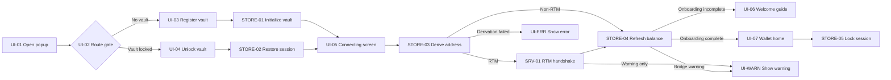
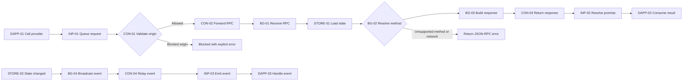
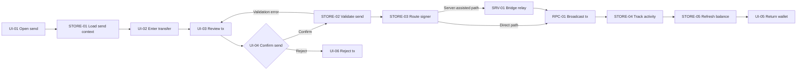
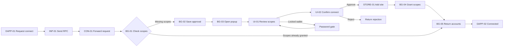

# MetaYoshi Wallet Mermaid Sources

These Mermaid diagrams use the same node ids as `docs/metayoshi-wallet-drawio-flow-specs.md` so they stay aligned with the draw.io-ready specs.

## Wallet Bootstrap And Session Lifecycle

## Provider Bridge Runtime

## Direct Wallet Send And Confirmation

## Dapp Connection Approval

## Dapp Transaction Approval And Execution

```mermaid
flowchart LR
  DAPP01["DAPP-01 Request tx"] --> INP01["INP-01 Forward tx"]
  INP01 --> CON01["CON-01 Relay tx"]
  CON01 --> BG01{"BG-01 Validate tx scope"}
  BG01 --> BG02["BG-02 Save request"]
  BG02 --> BG03["BG-03 Open request popup"]
  BG03 --> UI01["UI-01 Review request"]
  UI01 --> UI02{"UI-02 Approve or reject"}
  UI02 -->|"Approve"| STORE01["STORE-01 Switch context"]
  STORE01 --> STORE02["STORE-02 Execute send"]
  STORE02 -->|"Server-assisted path"| SRV01["SRV-01 Bridge relay"]
  STORE02 -->|"Direct path"| RPC01["RPC-01 Broadcast request"]
  SRV01 --> RPC01
  RPC01 --> STORE03["STORE-03 Record activity"]
  STORE03 --> STORE04["STORE-04 Restore context"]
  STORE04 --> BG04["BG-04 Return result"]
  BG04 --> DAPP02["DAPP-02 Receive tx result"]

  UI02 -->|"Reject"| BGREJ["Return rejection"]
  UI01 -->|"Locked wallet"| UIPW["Password gate"]
  UIPW --> UI01
  STORE02 -->|"Send failed"| BGFAIL["Return failure"]
```

