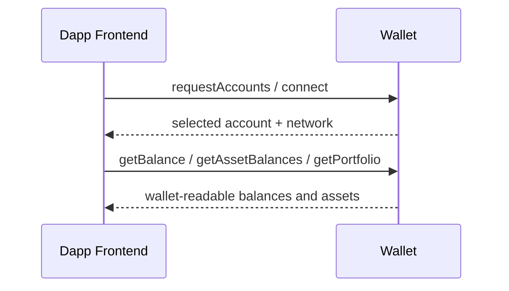
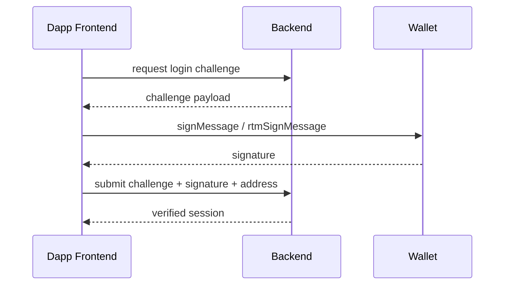
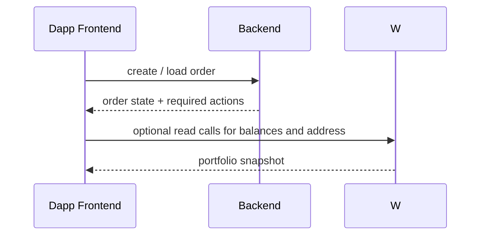
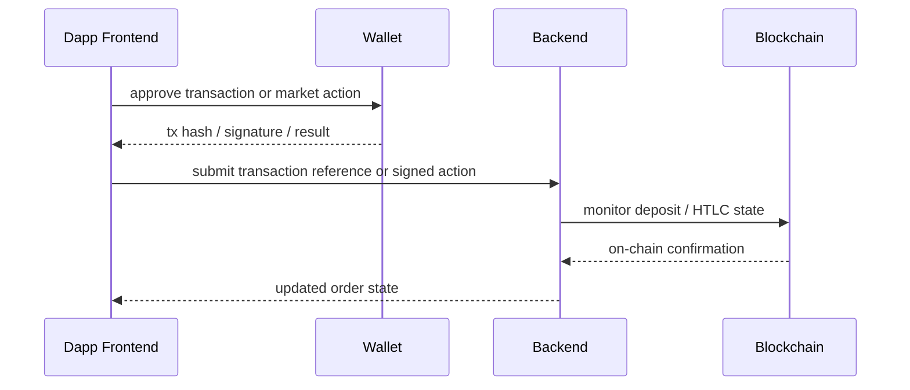

# MetaYoshi Dapp Flow Audit

## Responsibility Boundaries

### Wallet
- Non-custodial only.
- Exposes account and chain state.
- Exposes wallet-readable balances and asset inventory.
- Signs messages.
- Signs or sends transactions.
- Receives coin and token transfers through wallet-owned addresses.
- Must not generate backend login challenges, create orders, or orchestrate settlement logic.

### RtmShop Frontend
- UI orchestrator only.
- Connects to the wallet.
- Reads balances and account state from the wallet.
- Requests login challenge from backend.
- Shows orders and trade state.
- Initiates buy and sell flows.
- Presents the exact message, signature request, or transaction request to the user.
- Sends signed payloads and transaction references back to backend.

### Backend
- Trusted coordinator, not signer or custodian.
- Generates login challenges.
- Verifies signatures.
- Stores users, orders, and trades.
- Monitors chain state.
- Verifies deposits.
- Produces HTLC or escrow instructions.
- Advances order status.
- Orchestrates settlement and refund transitions.

### Blockchain
- Final source of truth.
- Confirms deposit of coin or token.
- Confirms HTLC lock.
- Confirms redeem.
- Confirms refund.

## Sequence Checks

### Wallet Connect

Checks:
- Dapp must not infer balances from auth flow.
- Wallet must not expose accounts before read permission is granted.
- Returned network and account must match the wallet-selected context.

### Login Challenge

Checks:
- Backend challenge format must be chain-aware.
- RTM challenge verification must match `wallet_rtmSignMessage`.
- Frontend must label this as authentication, not as a transfer.

### Order Creation and Trade Start

Checks:
- Wallet never creates or stores order business state.
- Backend remains source of trade intent and order progression.

### Sell / Buy / Deposit / Settlement

Checks:
- Frontend must not present backend-generated actions as on-chain transactions unless the wallet is actually broadcasting.
- Backend must not advance settlement or refund states without matching on-chain preconditions.
- Wallet result screens must distinguish signatures, key access, and broadcasts.

## Compatibility Checklist

### Wallet and Frontend
- Connect flow uses the same account and network that the wallet exposes.
- Frontend reads balances through wallet read APIs where available.
- RTM public-key access is treated as a distinct request, not as a transaction.
- RTM message signing is treated as a distinct request, not as generic EVM signing.

### Frontend and Backend
- Challenge payloads specify the chain and signature method.
- Backend auth config must advertise the same chain kinds the frontend expects.
- Order and settlement payloads must not assume EVM semantics for RTM.

### Backend and Blockchain
- Deposit checks require observable on-chain state.
- Settlement and refund depend on confirmed HTLC or transfer state.
- Off-chain order status cannot outrun on-chain confirmation policy.
